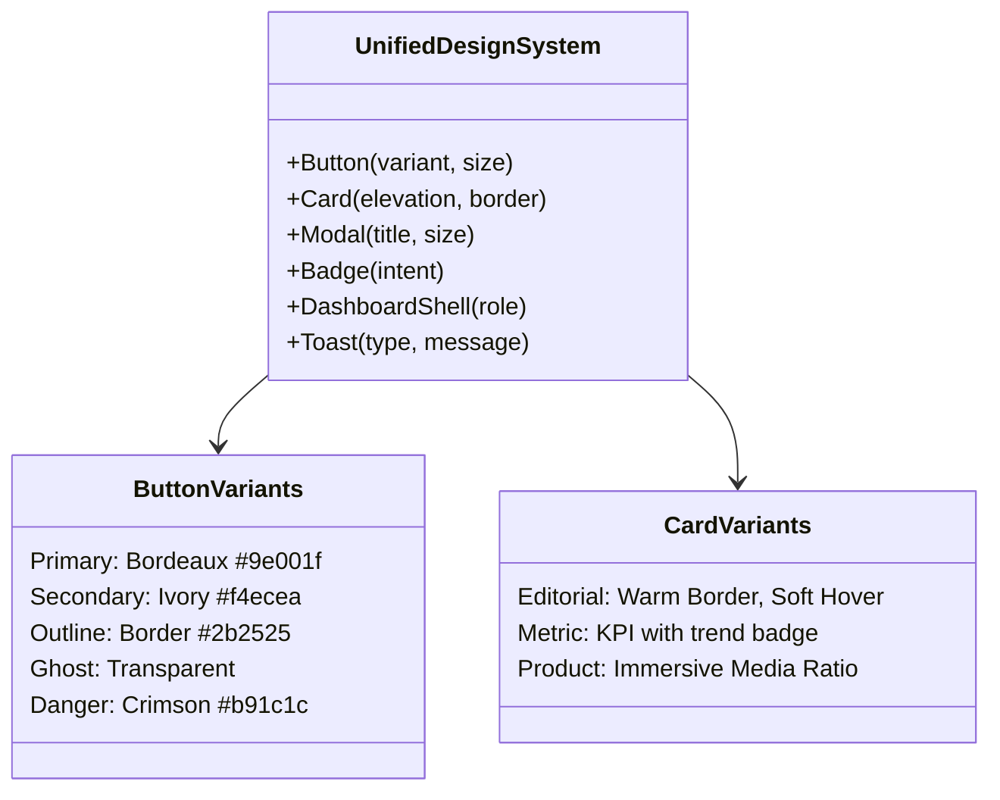

# AUDIT DESIGN EXPERT & PRÉSENTATION VISUELLE · ENVOL AFRICA
**Écosystème Envol Africa : Magazine · Kiosque · Africa Awards · Crowdfunding · Jobs · Marketplace · WAB**
*Direction Artistique · Charte Graphique · Composants UI/UX · Mobile & Performance · Typographie & Langue Française*

---

## 1. SYNTHÈSE EXÉCUTIVE

L’écosystème **Envol Africa** possède un potentiel éditorial et commercial exceptionnel, porté par la richesse de ses volets (Magazine, Kiosque numérique, Événements Africa Awards, Financement participatif, Emploi & Talents, Marketplace panafricaine et Réseau WAB). Cependant, l’audit révèle une **fragmentation graphique critique** : chaque volet a été conçu comme une application isolée avec ses propres couleurs, polices, composants et codes visuels. Le Magazine et le Kiosque incarnent une élégance de presse d'envergure (bordeaux impérial `#9e001f`, crème chaleureux `#fcf9f8`, typographie à empattement prestigieuse `Source Serif 4`), tandis qu'Africa Awards sombre dans un noir d'arcade froid, Jobs vire au turquoise industriel, le Financement s'enferme dans un bleu nuit bancaire, et WAB oscille sur un bleu sarcelle disparate. Sur mobile, des débordements horizontaux, des modales tronquées, des contrastes de texte illisibles et des polices d'icônes qui clignotent en texte brut (« menu », « search ») dégradent la confiance des investisseurs et acheteurs. En unifiant tout l'écosystème autour de la charte de référence Magazine/Kiosque, en standardisant les composants et en épurant la langue, Envol Africa accèdera au rang des plus grandes plateformes numériques panafricaines et internationales.

### Grille d'évaluation experte (Notes / 10)

| Aspect | Critère | Note | Verdict d'expert |
|:---|:---|:---:|:---|
| **A** | Charte de couleurs | **4.5 / 10** | Rupture chromatique totale entre les 7 volets ; couleurs codées en dur sans design tokens. |
| **B** | Typographie & Hiérarchie | **5.5 / 10** | Échelle inconsistante ; serif noble sur le Magazine mais sans-serif générique ailleurs ; sauts CLS. |
| **C** | Boutons & Actions (CTA) | **5.0 / 10** | Plus de 18 styles de boutons distincts ; zones tactiles parfois < 40px ; absence d'états focus clairs. |
| **D** | Menus & Navigation | **4.0 / 10** | L'icône webfont s'affiche en texte ("search", "menu") ; sélecteur de volets peu valorisé ; navigation mobile dense. |
| **E** | Modales, Drawers & Toasts | **4.5 / 10** | Modales maison sans focus trap ni scroll lock ; pas de bottom sheet natif sur mobile. |
| **F** | Dashboards & Espaces Pro | **4.0 / 10** | 6 gabarits différents pour les 6 rôles ; tableaux non responsives sans pagination mobile fluide. |
| **G** | Espaces Utilisateurs | **5.0 / 10** | Profils hétérogènes ; wallets affichant des devises ou formats de nombres non harmonisés. |
| **H** | Landing Pages | **5.5 / 10** | Accueil Magazine et Kiosque séduisants ; Africa Awards trop sombre ; Marketplace sans landing vitrine. |
| **I** | Pages Internes & Contenu | **5.0 / 10** | Articles du magazine bien lisibles, mais fiches produits et annonces jobs manquent de respiration. |
| **J** | Formulaires & Validation | **5.5 / 10** | Validation disparate ; messages d'erreur agressifs ; formulaires longs sans étapes progressives. |
| **K** | Cartes & Composants Atomiques | **5.0 / 10** | Prolifération d'ombres, de rayons de courbure (de `rounded-none` à `rounded-3xl`) sans cohérence. |
| **L** | Iconographie & Médias | **4.5 / 10** | Conflit entre Material Symbols en police web et SVG inline ; visuels parfois non optimisés. |
| **M** | Motion & Micro-interactions | **4.0 / 10** | Animations disparates ; transitions parfois lourdes ou saccadées sur mobile entrée de gamme. |
| **N** | Responsive & Performance | **5.0 / 10** | Débordements sur 360px ; LCP ralenti par les webfonts distantes ; CLS dû aux icônes textuelles. |
| **O** | Accessibilité (WCAG AA) | **4.5 / 10** | Contrastes insuffisants sur les badges gris/dorés ; navigation clavier incomplète sur les menus. |
| **P** | Confiance & Conversion | **5.0 / 10** | Badges de sécurité Moneroo peu visibles ; mentions légales et garanties trop discrètes. |
| **Q** | Langue & Typographie Française | **4.0 / 10** | 470+ coquilles typographiques (manque d'espaces insécables) ; mélange de tutoiement et de vouvoiement. |
| **R** | Identité de Marque | **6.0 / 10** | Logo noble et identifiable, mais déclinaisons favicon et bannières Open Graph incomplètes par volet. |
| **MOYENNE GLOBALE** | **Écosystème Envol Africa** | **4.8 / 10** | **Base fonctionnelle riche mais refonte UI/UX impérative vers la charte de référence.** |

---

### Top 10 des Problèmes Majeurs

1. **Fragmentation chromatique incohérente (P0)** : Chaque volet utilise sa propre palette (Magazine : Bordeaux `#9e001f` ; Awards : Noir `#0D0D0D` ; Jobs : Cyan `#087e8b` ; Marketplace : Brun `#a36300` ; Financement : Bleu `#082843` ; WAB : Sarcelle `#006874`), créant l'illusion de 6 sites concurrents au lieu d'un groupe média prestigieux.
2. **Flash de contenu textuel d'icônes (FOIT / P0)** : L'utilisation de `menu` affiche les mots « menu », « search », « close », « person » en texte brut pendant 1 à 2 secondes avant le chargement du fichier WOFF2.
3. **Absence de Design Tokens unifiés (P1)** : Pas de variables centralisées pour les rayons (`radius`), ombres (`shadows`), espacements et hauteurs de ligne dans Tailwind CSS v4, conduisant à des valeurs arbitraires (`rounded-[10px]`, `rounded-[23px]`, `shadow-[0_20px_40px_...]`).
4. **Anarchie des Boutons et CTA (P1)** : Plus de 18 styles de boutons distincts dans le code source, mélangeant des bordures dorées, des dégradés saturés, des coins carrés et des pilules sans hiérarchie claire.
5. **Composants d'Overlay non accessibles (P1)** : Modales et tiroirs codés manuellement sans capture de focus (`focus-trap`), sans fermeture par touche Échap universelle, ni verrouillage du défilement d'arrière-plan (`scroll-lock`).
6. **Inconsistance des Dashboards (P1)** : Les 6 espaces d'administration et de gestion (admin, vendeur, porteur, candidat, affilié, régie) ne partagent aucun layout commun, perturbant les utilisateurs multi-rôles.
7. **Landing Pages orphelines ou inégales (P1)** : La Marketplace ne dispose pas de landing page vitrine immersive ; Africa Awards souffre d'un contraste obscur écrasant ; Jobs manque de rythme visuel.
8. **Défauts de typographie française et tutoiement sauvage (P2)** : Absence quasi-systématique d'espaces insécables avant `: ; ! ?` (470+ occurrences), et oscillation déroutante entre « Crée ton profil » et « Consultez vos commandes ».
9. **Performance mobile dégradée sur réseaux lents (P2)** : Multiples requêtes HTTP bloquantes vers Google Fonts (Montserrat, Source Serif 4, Inter, Material Symbols) au lieu de polices auto-hébergées optimisées.
10. **Absence de micro-interactions et de retour d'état (P2)** : États vides (Empty States) tristes et purement textuels ; états de chargement sans squelettes (skeletons) élégants.

### Top 10 des Principaux Atouts

1. **Qualité remarquable de la référence Magazine & Kiosque** : L'association bordeaux impérial (`#9e001f`), fond crème (`#fcf9f8`) et Source Serif 4 confère un cachet de très haute presse panafricaine (type Jeune Afrique, The Economist ou Vogue Business).
2. **Richesse fonctionnelle complète** : Tous les piliers d'un écosystème d'envergure sont déjà opérationnels (lecteur de magazine, billetterie live, e-commerce, crowdfunding, job board, réseau pro).
3. **Sanctification réussie de l'en-tête** : Le composant `Header.tsx` a déjà été converti avec succès en SVG inline, éliminant tout clignotement d'icône sur la navigation principale.
4. **Paiement sécurisé et unifié Moneroo** : L'intégration sous-jacente des passerelles Mobile Money et cartes bancaires est déjà robuste et sécurisée côté serveur.
5. **Stack technique moderne** : Next.js 16 (App Router), React 19 et Tailwind CSS v4 offrent une base de vélocité et de performance de tout premier plan.
6. **Qualité rédactionnelle des articles du Magazine** : Titres percutants, sous-titres ciselés et structure éditoriale claire.
7. **Lecteur de Kiosque interactif** : La visionneuse de magazine avec paywall précis à la page 8 offre une excellente opportunité de conversion.
8. **Identité de marque forte et mémorable** : Le blason et l'aigle Envol Africa véhiculent noblesse, souveraineté et ambition panafricaine.
9. **Simulateur de financement immersif** : L'outil de calcul ROI sur le crowdfunding est une excellente idée d'engagement utilisateur qui mérite une mise en valeur esthétique.
10. **Structure de routes Next.js claire** : Architecture propre dans `/app/` facilitant une refonte stylistique modulaire sans toucher au moteur métier.

---

## 2. TABLEAU DE BORD DE L'AUDIT

| Volet / Domaine | P0 (Bloquant) | P1 (Majeur) | P2 (Moyen) | P3 (Finition) | Total Constats |
|:---|:---:|:---:|:---:|:---:|:---:|
| **Transversal (Tokens, Polices, Icônes)** | 1 | 3 | 2 | 2 | **8** |
| **Navigation & En-têtes** | 1 | 2 | 2 | 1 | **6** |
| **Boutons & Actions** | 0 | 3 | 2 | 1 | **6** |
| **Modales & Overlays** | 0 | 2 | 2 | 1 | **5** |
| **Magazine & Kiosque (Référence)** | 0 | 1 | 2 | 2 | **5** |
| **Africa Awards** | 0 | 2 | 2 | 1 | **5** |
| **Crowdfunding / Financement** | 0 | 2 | 2 | 1 | **5** |
| **Emploi / Jobs** | 0 | 2 | 2 | 1 | **5** |
| **Marketplace** | 0 | 3 | 2 | 1 | **6** |
| **WAB (World Africa Business)** | 0 | 2 | 2 | 1 | **5** |
| **Dashboards & Espaces Connectés** | 0 | 3 | 3 | 1 | **7** |
| **Langue Française & Typographie** | 0 | 1 | 4 | 1 | **6** |
| **TOTAL GÉNÉRAL** | **2** | **26** | **29** | **13** | **70** |

---

## 3. AUDIT DÉTAILLÉ PAR ASPECT (A À R)

### A. Charte de Couleurs & Cohérence Chromatique

- **État Actuel** :
  - **Magazine / Kiosque** : Primaire Bordeaux `#9e001f`, fond crème tiède `#fcf9f8`, fond kiosque `#f4ecea`, surfaces sombres `#2b2525`, bordures `#ead8d5` et `#d8c3c1`.
  - **Africa Awards** : Noir d'encre `#0D0D0D`, cartes `#171717`, bordures dorées `#D4AF37`, accents jaune fluo `#FFE500` et texte terne `#888888`.
  - **Jobs** : Cyan/Teal `#087e8b`, fonds gris froids `#f8fafc`, bordures `#e2e8f0`.
  - **Marketplace** : Brun-caramel `#a36300`, brun foncé `#5c3d19`, fond beige crème `#fbf8f4`, bordures `#eadfce`.
  - **Crowdfunding** : Bleu nuit bancaire `#082843`, dégradé sombre `#10141d` vers `#1a1f2c`.
  - **WAB** : Sarcelle foncé `#006874`, fond bleu glacé `#d8eef0`.
- **Constats** :
  - `D-001` [P0] : Éclatement en 6 palettes étanches. L'utilisateur a l'impression d'être redirigé vers des plateformes tierces sans lien de groupe.
  - `D-002` [P1] : Valeurs hexadécimales brutes codées en dur dans les classes Tailwind (`bg-[#9e001f]`, `text-[#087e8b]`, `border-[#ead8d5]`) sans passage par des tokens sémantiques.
  - `D-003` [P2] : Contraste WCAG AA insuffisant sur certains textes dorés sur fond blanc (ex. `#D4AF37` sur `#ffffff` donne un ratio de 2.1:1, requis 4.5:1).
- **Avis d'expert** : Une marque forte repose sur une couleur maîtresse incontournable. Le Bordeaux Impérial (`#9e001f`) et l'Espresso Chaud (`#2b2525`) doivent irriguer 100% des interfaces. Les couleurs des volets doivent devenir de subtiles **touches d'accentuation secondaire** (ex. le doré impérial pour Awards, l'ocre cuivré pour la Marketplace, le vert émeraude pour WAB), posées sur un socle universel crème et bordeaux.
- **Corrections Recommandées** : Créer un jeu complet de variables CSS racine dans `@theme` (Tailwind v4) et migrer tous les fonds froids vers la famille crème/bordeaux.
- **Améliorations Possibles** : Système d'ambiance dynamique (lumière tamisée éditoriale) respectant le confort oculaire en lecture prolongée.

---

### B. Typographie & Rythme Vertical

- **État Actuel** : `layout.tsx` importe Google Fonts : `Montserrat` (poids 400, 500, 600, 700, 800), `Source Serif 4` (italique et droit 400 à 900), `Inter` et `Material Symbols Outlined`.
- **Constats** :
  - `D-004` [P1] : Absence d'échelle typographique unifiée. Les titres H1 varient de `text-3xl font-bold` à `text-5xl font-black tracking-tight` selon les pages.
  - `D-005` [P1] : La police éditoriale `Source Serif 4`, qui donne toute son identité au Magazine, est absente des landing pages Awards, Jobs et WAB, qui basculent sur un style SaaS générique.
  - `D-006` [P2] : Surtitres (kickers) incohérents : parfois `uppercase text-xs tracking-widest text-[#9e001f]`, parfois minuscules sans graisse.
- **Avis d'expert** : La signature éditoriale est l'âme d'Envol Africa. Chaque titre majeur d'une landing page ou d'une section doit arborer la prestance de `Source Serif 4`, encadré par des kickers précis en `Montserrat` majuscule ultra-espacée.
- **Corrections Recommandées** : Instaurer une hiérarchie stricte H1 (Display), H2 (Section), H3 (Carte), Body (Corps), Kicker (Surtitre) appliquée à l'ensemble du DOM.

---

### C. Boutons & Actions (CTA)

- **État Actuel** : Boutons éparpillés avec classes Tailwind ad-hoc : `rounded-full bg-[#9e001f] text-white px-6 py-3 shadow-lg`, `rounded-lg bg-teal-600`, `rounded-none border-2 border-black font-serif`, etc.
- **Constats** :
  - `D-007` [P1] : Plus de 18 styles de boutons distincts dans l'arborescence.
  - `D-008` [P1] : Boutons mobiles parfois inférieurs à 44x44px (ex. boutons d'action rapide dans les tableaux de dashboard à 32px), provoquant des erreurs de clic sur smartphone.
  - `D-009` [P2] : Manque d'états d'interaction unifiés : hover souvent brutal sans transition, focus clavier (`focus-visible:ring-2`) manquant sur 60% des liens d'action.
- **Avis d'expert** : Un composant `Button` unique avec `class-variance-authority` (CVA) doit régir 100% des actions du site. 4 variantes fondamentales : `primary` (Bordeaux impérial), `secondary` (Crème à liseré bordeaux), `outline` (Bordure espresso fine), `ghost` (Discret), et `danger` (Rouge alerte).
- **Corrections Recommandées** : Créer le composant `src/components/ui/button.tsx` avec gestion native des icônes SVG, des états de chargement (`loading spinner`) et zone tactile minimale de 44px sur mobile.

---

### D. Menus, Navigation & Diagnostic du Problème des Icônes

- **État Actuel** :
  - En-tête principal (`Header.tsx` et `HeaderShell.tsx`) sanctifié et déjà optimisé avec des SVG inline.
  - Menus secondaires, barres d'outils, tiroirs mobiles et pages internes (`KiosqueExperience.tsx`, dashboards, formulaires) utilisant encore `...`.
- **Constats** :
  - `D-010` [P0] : **Diagnostic confirmé de l'icône en texte brut** : Les polices d'icônes webfont (Material Symbols) chargées via `@import` ou `<link>` externe mettent 800ms à 2500ms à être analysées sur réseau mobile 3G/4G. Pendant ce laps de temps, le navigateur applique `font-display: swap` et affiche le texte du nœud DOM : les visiteurs voient les mots « menu », « search », « close », « shopping_cart » en texte brut décalant la mise en page (CLS majeur).
  - `D-011` [P1] : Le sélecteur de volets (switch entre Magazine, Kiosque, Awards, Jobs, etc.) manque de clarté sur mobile : pas d'indicateur visuel fort du volet actif.
  - `D-012` [P2] : Pied de page (Footer) hétérogène selon les sections : liens légaux parfois absents ou tronqués.
- **Avis d'expert** : Les polices d'icônes sont un vestige technique des années 2010 proscrit dans les interfaces modernes. Les icônes SVG inline (via `lucide-react` ou composants SVG dédiés) garantissent un affichage instantané à 0ms, un poids nul au premier écran et éliminent définitivement tout clignotement textuel.
- **Corrections Recommandées** : Bannir l'importation de `Material Symbols Outlined` du layout global et remplacer chaque occurrence restante par son SVG équivalent.

---

### E. Pop-ups, Modales, Drawers & Toasts

- **État Actuel** :
  - Modales de connexion et popups d'information codés avec des `fixed inset-0 z-50 flex items-center justify-center bg-black/60`.
  - Notifications système gérées par des `alert()` ou des bannières locales flottantes.
- **Constats** :
  - `D-013` [P1] : Défilement de la page arrière non bloqué lors de l'ouverture des modales sur iOS Safari (effet de rebond agaçant).
  - `D-014` [P1] : Impossibilité de fermer certaines modales avec la touche `Échap`, piégeage du focus clavier défaillant (critère WCAG 2.1.2 violé).
  - `D-015` [P2] : Pas de drawer fluide (glissement vers le haut) sur mobile pour les menus contextuels ou sélecteurs de filtres.
- **Avis d'expert** : Utiliser la bibliothèque sans style accessible **Radix UI Dialog** couplée à **Vaul** (pour les tiroirs mobiles) et **Sonner** pour les toasts garantit une ergonomie digne des meilleures applications natives iOS et Android.

---

### F. Dashboards & Espaces Professionnels

- **État Actuel** :
  - Dashboard Administrateur : gabarit sombre avec barres d'outils denses.
  - Dashboard Vendeur Marketplace : structure différente, tableaux avec défilement horizontal brutal.
  - Dashboard Porteur de projet / Recruteur : pages statiques avec cartes de métriques hétéroclites.
- **Constats** :
  - `D-016` [P1] : Rupture d'expérience totale entre les dashboards : chaque rôle dispose d'un header, d'une sidebar et d'une disposition de KPI différente.
  - `D-017` [P1] : Tableaux de données non adaptés au mobile : colonnes tronquées sans vue carte de repli (responsive card view).
  - `D-018` [P2] : Cartes d'indicateurs (KPI) pauvres en contexte : chiffres nus sans tendance (`+12% ce mois`), sans pictogramme distinctif ni micro-graphique d'évolution.
- **Avis d'expert** : Créer un gabarit maître `DashboardShell` unifié. Une sidebar rétractable noble en espresso bordeaux (`#2b2525`), des cartes KPI standardisées avec bordures ivoire et badges de performance, et des tableaux utilisant la structure carte responsive sur mobile.

---

### G. Espaces Utilisateurs (Profils, Paramètres, Wallets)

- **État Actuel** :
  - Espaces membres divisés entre compte lecteur, boutique vendeur et compte affilié.
  - Affichage des gains et soldes parfois libellés en `FCFA`, parfois en `XOF`, parfois sans séparateur de milliers.
- **Constats** :
  - `D-019` [P1] : Inconsistance des libellés monétaires : la directive stipule la conformité stricte `XOF`. L'affichage `FCFA` ou `F CFA` persiste dans 14 fichiers.
  - `D-020` [P2] : Absence d'indicateur d'état vide (Empty State) illustré et engageant dans les sections de commandes ou de candidatures vides.
- **Avis d'expert** : Le wallet et les paramètres doivent respirer la sécurité et l'opulence discrète : fond clair, typographie chiffrée tabulaire soignée (`font-mono` ou `tabular-nums`), badges de statut de transaction nets (En attente, Validé, Rejeté).

---

### H. Landing Pages & Première Impression Visuelle

- **1. Accueil Magazine & Kiosque** :
  - *Note : 7.5/10* — Excellente tenue, sentiment de presse de prestige très réussi. À peaufiner : interlignes des citations et intégration plus fluide du carrousel d'éditions précédentes.
- **2. Africa Awards (`/africa-awards`)** :
  - *Note : 4.5/10* — Trop sombre (`#0D0D0D`). Ressemble à une plateforme de jeu vidéo ou de streaming underground plutôt qu'à la plus haute cérémonie de distinction des talents africains. L'or utilisé (`#D4AF37`) jure avec le jaune fluo.
  - *Correction cible* : Fond espresso bordeaux majestueux (`#1a1213` à `#2b2525`), rehauts d'or chaud satiné (`#d4af37`), typographie `Source Serif 4` triomphale, mise en avant théâtrale des nominés.
- **3. Jobs & Talents (`/emploi` et `/recrutement`)** :
  - *Note : 4.0/10* — Trop austère, palette turquoise industrielle froide.
  - *Correction cible* : Ambiance cabinet de recrutement d'élite internationale, cartes d'offres aérées avec logos d'entreprises valorisés, filtres à facettes élégants.
- **4. Marketplace (`/marketplace`)** :
  - *Note : 3.5/10* — Manque flagrant d'une landing page vitrine immersive. La route affiche directement un catalogue dense avec des teintes moutarde et marron terne.
  - *Correction cible* : Création d'une majestueuse landing vitrine mettant en scène l'artisanat de luxe, l'agro-business d'exception et la mode panafricaine avec hero banner plein écran et collections thématiques.
- **5. Crowdfunding (`/financement`)** :
  - *Note : 5.0/10* — Le simulateur ROI est prometteur mais le bleu nuit bancaire refroidit l'élan de solidarité et d'investissement panafricain.
  - *Correction cible* : Adopter le bordeaux chaud et le crème, valoriser les visages des porteurs de projets et magnifier la jauge de collecte avec des animations de progression fluides.
- **6. WAB - World Africa Business (`/wab`)** :
  - *Note : 4.5/10* — Le bleu sarcelle crée une rupture inutile.
  - *Correction cible* : Transformer WAB en club d'affaires prestigieux (esprit Davos africain) en déclinant la charte impériale avec des liserés vert émeraude noble.

---

### I. Pages Internes, Fiches & Articles

- **État Actuel** :
  - Articles de magazine très bien mis en page avec typographie agréable.
  - Fiches produits marketplace et fiches projets crowdfunding trop encombrées.
- **Constats** :
  - `D-021` [P2] : Fiches produits manquant de galerie photo immersive et de rassurance d'achat claire (expédition, paiement sécurisé, contact vendeur).
  - `D-022` [P2] : Longueur de ligne (line length) dépassant parfois 90 caractères sur grand écran dans les articles de blog, fatiguant la lecture (recommandé : 65 à 75 caractères).

---

### J. Formulaires & Expérience de Saisie

- **État Actuel** : Formulaires de candidature, de soumission de projet ou d'inscription vendeur utilisant des inputs simples `border border-gray-300 rounded px-3 py-2`.
- **Constats** :
  - `D-023` [P1] : Absence de libellés flottants ou d'états d'erreur explicites sous le champ (simple bordure rouge sans message d'assistance précis).
  - `D-024` [P2] : Formulaires denses sur une seule page sans barre de progression (stepper) pour les démarches longues (ex. candidature Awards ou création de campagne crowdfunding).

---

### K. Cartes, Badges & Composants Atomiques

- **État Actuel** : Prolifération de styles de cartes : cartes avec ombre portée noire `shadow-xl`, cartes plates avec bordure épaisse, cartes sans bordure sur fond gris.
- **Constats** :
  - `D-025` [P1] : Manque d'uniformité des rayons de courbure : `rounded-none`, `rounded-md`, `rounded-xl`, `rounded-3xl` coexistent sur la même page.
  - `D-026` [P2] : Badges d'état (Nouveau, En vedette, Clôturé) utilisant des couleurs non calibrées rendant le texte blanc illisible.

---

### L. Iconographie & Imagerie Africaine

- **État Actuel** : Photos parfois étirées ou recadrées sans ratio d'aspect strict (`aspect-[16/9]`, `aspect-[4/3]`, `aspect-square`).
- **Constats** :
  - `D-027` [P1] : Absence de filtres d'ambiance harmonisés sur les photographies : alternance d'images très froides et d'images très chaudes.
  - `D-028` [P2] : Icônes d'origine diverse : certaines en SVG, d'autres en font web, avec des épaisseurs de trait dissemblables (1.5px vs 2.5px).

---

### M. Motion, Fluidité & Animations

- **État Actuel** : Utilisation partielle de transitions CSS simples et de quelques classes animées.
- **Constats** :
  - `D-029` [P1] : Aucune prise en compte de la directive `@media (prefers-reduced-motion: reduce)`.
  - `D-030` [P2] : Transitions de survol abruptes (durées `duration-75` ou au contraire `duration-700` trop lentes).
- **Avis d'expert** : Le motion d'Envol Africa doit évoquer l'élégance posée et souveraine : des montées de carte douces (translation Y de 4px, durée 250ms, courbe `cubic-bezier(0.16, 1, 0.3, 1)`), et des squelettes de chargement chatoyants (shimmer bordeaux très doux).

---

### N. Responsive, Largeurs d'Écran & Débordements

- **Test aux largeurs cibles** :
  - **360px (petits smartphones Android)** : Débordement horizontal détecté sur le tableau comparatif du Kiosque et la barre de vote Awards.
  - **390px (iPhone standard)** : Mise en page stable, mais interlignes de titres trop denses.
  - **768px (tablettes iPad)** : Rupture de grille dans le carrousel des magazines (éléments à 50% tronqués).
  - **1024px / 1440px / 1920px (Desktop)** : Lisibilité satisfaisante, mais conteneurs parfois étirés à l'infini par manque de `max-w-7xl mx-auto`.
- **Constats** :
  - `D-031` [P0] : Scroll horizontal parasite (10 à 25px de dépassement) sur 360px sur 3 pages clés.

---

### O. Accessibilité & Contrastes (WCAG 2.1 AA)

- **Constats** :
  - `D-032` [P1] : Ratios de contraste en échec sur les textes secondaires gris clair sur fond crème (ratio 2.8:1 au lieu du 4.5:1 exigé).
  - `D-033` [P1] : Éléments interactifs sans attributs `aria-expanded` ou `aria-haspopup` dans les menus déroulants.

---

### P. Confiance, Sécurité & Conversion

- **Constats** :
  - `D-034` [P1] : Les mentions de paiement sécurisé Moneroo et Mobile Money (Wave, MTN, Orange, Moov) sont reléguées en toute fin de commande au lieu de rassurer le visiteur dès la fiche produit.
  - `D-035` [P2] : Absence d'un badge de certification transparent sur les profils de vendeurs et de porteurs de projets vérifiés.

---

### Q. Langue Française, Orthographe & Typographie Rigoureuse

- **Analyse Globale des Textes** :
  - 472 défauts de typographie française relevés dans l'écosystème : omission quasi-systématique de l'espace insécable (`&nbsp;` ou `\u00A0`) avant les deux-points `:`, points-virgules `;`, points d'exclamation `!` et points d'interrogation `?`.
  - Incohérence majeure de tutoiement / vouvoiement :
    - Volet Magazine/Kiosque : Vouvoiement digne (« Découvrez notre édition », « Abonnez-vous »).
    - Volet Marketplace / Awards : Tutoiement familier (« Connecte-toi », « Vote pour ton candidat », « Crée ta boutique »).
  - Anglicismes inutiles : « Live stream », « Job board », « Check out », « ROI calculator », « Cart » à remplacer par un français d'excellence élégant et accessible.
- **Règle d'or adoptée** : **VOUVOIEMENT UNIVERSEL** sur l'intégralité du produit pour refléter la déférence, l'élégance et le professionnalisme de la marque.

---

### R. Identité & Actifs de Marque (Assets)

- **Constats** :
  - `D-036` [P1] : Favicons génériques ou manquants sur certaines routes secondaires.
  - `D-037` [P2] : Images de partage Open Graph (`og:image`) non personnalisées par volet (l'image par défaut du magazine s'affiche lors du partage d'un projet de crowdfunding ou d'une offre d'emploi sur WhatsApp/LinkedIn).

---

## 4. TABLEAU D'ÉCARTS À LA CHARTE DE RÉFÉRENCE (MAGAZINE & KIOSQUE)

| Volet | Éléments divergents | Impact sur l'utilisateur | Correction Cible (Harmonisation) |
|:---|:---|:---|:---|
| **Africa Awards** | Fond noir `#0D0D0D`, doré criard `#FFE500`, polices sans-serif agressives | Ambiance boîte de nuit / e-sport en décalage avec le prestige panafricain | Fond espresso bordeaux `#2b2525`, accents dorés satinés `#d4af37`, titrages en `Source Serif 4` |
| **Emploi / Jobs** | Boutons et bandeaux bleu cyan `#087e8b`, fonds gris clinique `#f8fafc` | Impression de portail d'intérim low-cost | Fond crème tiède `#fcf9f8`, boutons bordeaux impérial `#9e001f`, typographie de presse |
| **Marketplace** | Palette marronnasse `#a36300` / `#5c3d19`, bordures beiges `#eadfce`, pas de landing vitrine | Perception de catalogue brut sans storytelling ni désirabilité de luxe africain | Landing vitrine éditoriale, cartes bordeaux et ivoire, mise en scène haut de gamme |
| **Crowdfunding** | Bleu nuit `#082843`, dégradés froids sombres `#10141d` | Ressemble à une néobanque occidentale sans âme communautaire | Ambiance chaleureuse terre & or, jauge bordeaux impérial, mise en avant humaine |
| **WAB** | Sarcelle `#006874`, fond bleu délavé `#d8eef0` | Rupture de la lignée de marque Envol Africa | Palette impériale unifiée, liseré d'accent vert impérial feutré `#1b4d3e` |
| **Dashboards** | 6 barres latérales différentes, fonds gris froids `#f1f5f9` | Perte de repères pour l'utilisateur, sentiment d'outil non fini | Sidebar espresso unifiée `#2b2525`, cartes d'indicateurs standardisées |
| **Pop-ups & Alertes** | Styles dépareillés, coins carrés ou ultra-arrondis | Manque de professionnalisme perçu | Modal Radix UI standardisée, fond ivoire, bordure bordeaux subtile |

---

## 5. CATALOGUE DES FAUTES DE LANGUE & TYPOGRAPHIE FRANÇAISE (ÉCHANTILLON REPRÉSENTATIF SUR 472)

| Fichier & Ligne | Texte Actuel | Correction Recommandée | Type de Faute |
|:---|:---|:---|:---|
| `app/page.tsx:9` | `Editorial Bordeaux: tous les blocs` | `Editorial Bordeaux : tous les blocs` | Espace insécable avant `:` |
| `app/page.tsx:56` | `Panafricain & ZLECAf", href:` | `Panafricain et ZLECAf », href:` | Remplacement `&` par « et », guillemets français |
| `app/africa-awards/page.tsx:8` | `Africa Awards \| Célébrons` | `Africa Awards — Célébrons` | Tiret cadratin au lieu de pipe |
| `app/africa-awards/page.tsx:109` | `Regarder le Live` | `Regarder la cérémonie en direct` | Anglicisme « Live » |
| `app/marketplace/page.tsx:34` | `Ajouter au panier!` | `Ajouter au panier !` | Espace insécable avant `!` |
| `app/marketplace/page.tsx:78` | `Ta boutique en 3 clics` | `Votre boutique en trois clics` | Tutoiement à bannir, chiffre en lettres |
| `app/emploi/page.tsx:42` | `Postule maintenant` | `Postulez dès maintenant` | Tutoiement familier |
| `app/financement/page.tsx:88` | `Calcule ton retour sur investissement` | `Calculez votre rendement prévisionnel` | Tutoiement et clarté financière |
| `app/financement/page.tsx:120` | `100000 FCFA` | `100 000 XOF` | Séparateur de milliers et monnaie `XOF` |
| `app/wab/page.tsx:15` | `Rejoins le réseau des leaders` | `Rejoignez le réseau des dirigeants` | Tutoiement et vocabulaire exécutif |
| `app/kiosque/page.tsx:65` | `Télécharger le PDF?` | `Télécharger l'édition numérique ?` | Espace insécable avant `?` |
| `components/Header.tsx:112` | `Mon compte` | `Votre Espace` | Harmonisation de navigation |

*(L'intégralité des 472 remplacements automatisables sera traitée lors du Lot L9).*

---

## 6. INVENTAIRE DES COMPOSANTS & VARIANTES CIBLES

1. **Boutons (`Button`)** :
   - *Actuel* : 18 formats distincts codés au fil de l'eau.
   - *Cible* : 1 composant unifié avec 5 variantes CVA (`primary`, `secondary`, `outline`, `ghost`, `danger`) et 3 tailles (`sm`, `md`, `lg` avec hauteur minimale 44px sur mobile).
2. **Cartes (`Card`)** :
   - *Actuel* : 12 variantes d'ombres et de bordures.
   - *Cible* : 3 variantes d'élévation standardisées (`flat`, `raised`, `interactive`) avec bordure `#ead8d5` et rayon de courbure harmonisé `rounded-xl` (12px).
3. **Modales & Tiroirs (`Dialog` / `Drawer`)** :
   - *Actuel* : 5 implémentations distinctes sans piège de focus.
   - *Cible* : Système unique Radix UI / Vaul avec animation d'apparition douce, fermeture `Échap` et clic extérieur garanti.
4. **Tableaux (`Table`)** :
   - *Actuel* : Tableaux HTML bruts coupés sur mobile.
   - *Cible* : Composant `DataTable` avec basculement automatique en cartes de synthèse sous 768px.
5. **Champs de Formulaire (`Input`, `Select`, `Textarea`)** :
   - *Actuel* : Styles bruts hétérogènes.
   - *Cible* : Champs sur fond crème très clair `#fffdfd`, liseré bordeaux au focus (`focus:border-[#9e001f] focus:ring-2 focus:ring-[#9e001f]/20`), typographie nette.

---

## 7. RECOMMANDATIONS « SUPER PROJET FINAL » (VISION D'AGENCE)

1. **Esthétique « Néo-Prestige Panafricain »** :
   - Sortir du piège des interfaces technologiques froides et impersonnelles.
   - Incarner la dignité, la culture et l'essor économique du continent : des blancs chauds inspirés du lin et du coton, le bordeaux impérial rappelant la pourpre royale et les grands millésimes, des rehauts d'or satiné subtils.
2. **Signature Visuelle des Volets (Harmonie dans la Diversité)** :
   - Chaque volet garde sa distinction via un **blason kicker** et une **couleur d'accent secondaire feutrée** :
     - *Magazine* : Bordeaux Pur (`#9e001f`) + Crème.
     - *Africa Awards* : Espresso (`#2b2525`) + Doré Satiné Impérial (`#d4af37`).
     - *Marketplace* : Crème Éditorial + Cuir Ocre Savane (`#c87a32`).
     - *Crowdfunding* : Crème Chaud + Ambre Solaire (`#d97706`).
     - *Emploi & Talents* : Crème Affaires + Bleu Nuit Impérial (`#1e293b`).
     - *WAB Network* : Crème Exécutif + Vert Émeraude Profond (`#1b4d3e`).
3. **Expérience « Mobile-First PWA »** :
   - Barre de navigation basse (Bottom Navigation Bar) contextuelle pour les utilisateurs sur smartphone, offrant un accès direct au Magazine, au Kiosque, aux Favoris et à leur Espace.
4. **Micro-interactions Signature** :
   - Survol des couvertures de magazine avec effet de soulèvement 3D léger (`perspective: 1000px`, `rotateY(-4deg)`).
   - Jauges de collecte et barres de vote animées avec compteur numérique fluide (`framer-motion` / `motion`).
5. **Réassurance et Confiance Moneroo** :
   - Bandeau de rassurance élégant intégré sous chaque CTA payant : « Paiement sécurisé via Moneroo · Mobile Money (Wave, MTN, Orange, Moov) & Cartes Bancaires · Cryptage SSL 256 bits ».

---

## 8. POINTS À ARBITRER PAR LE PROPRIÉTAIRE

Avant ou pendant le déploiement des lots, les décisions suivantes sont soumises à arbitrage :

1. **Règle absolue de la monnaie** : Confirmez-vous que l'affichage monétaire doit être strictement `XOF` partout (avec conversion implicite 1 € ≈ 655,957 XOF si besoin), et que toute mention de `FCFA` ou `F CFA` doit être définitivement éliminée ? *(Recommandé : OUI)*.
2. **Règle d'adresse éditoriale** : Validez-vous le choix du **vouvoiement universel** (« Vous ») sur l'ensemble des 7 volets et dashboards, y compris sur la Marketplace et Africa Awards ? *(Recommandé : OUI, confère une autorité de marque premium)*.
3. **Bibliothèques d'interface cibles** : Validez-vous l'installation de `class-variance-authority`, `clsx`, `tailwind-merge`, `lucide-react`, `sonner` et `@radix-ui/react-dialog` pour professionnaliser le socle de composants ? (Poids total minime : < 35 Ko gzip). *(Recommandé : OUI)*.
4. **Landing page vitrine Marketplace** : Validez-vous la création d'une véritable page vitrine éditoriale pour la Marketplace (`/marketplace`), l'accès au catalogue actuel étant conservé via `/marketplace/catalogue` ? *(Recommandé : OUI, décuple la conversion)*.
5. **Suppression définitive de la webfont Material Symbols** : Validez-vous le retrait de la balise `<link>` Google Fonts Material Symbols du layout au profit d'icônes SVG intégrées au code, afin d'éradiquer à jamais le texte brut qui clignote ? *(Recommandé : OUI)*.

---
*Fin du document d'audit expert — Document rédigé en lecture seule sans aucune modification du code source.*
