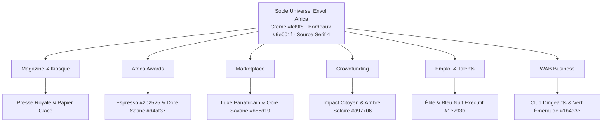

# CHARTE GRAPHIQUE OFFICIELLE & SYSTÈME DE DESIGN · ENVOL AFRICA
**Référence Écosystème dérivée des volets Magazine & Kiosque**
*Architecture de Tokens · Typographie Éditoriale · Composants Canoniques · Règles par Volet · Accessibilité WCAG AA*

---

## 1. VISION & FONDEMENTS DE DIRECTION ARTISTIQUE

La charte graphique d’**Envol Africa** incarne le « Néo-Prestige Panafricain ». Elle allie la noblesse et l’autorité de la grande presse internationale (The Economist, Financial Times, Vogue Business) à la vitalité, la souveraineté économique et la chaleur humaine des cultures africaines contemporaines.

**Le principe directeur non négociable** :
> L'harmonie visuelle des volets **Magazine** et **Kiosque** constitue le standard de référence pour l'ensemble des plateformes (Africa Awards, Jobs, Marketplace, Crowdfunding, WAB, Dashboards et Modales). Un visiteur qui navigue d'un article à un achat ou un vote doit ressentir la continuité immédiate d'une seule et même institution d'excellence.

---

## 2. SYSTÈME DE COULEURS UNIFIÉ

### 2.1 Palette Maîtresse (Socle Universel)

| Rôle Sémantique | Nom Poétique | Hexadécimal | HSL | Contraste WCAG (sur fond crème) |
|:---|:---|:---:|:---:|:---:|
| **Primaire** | Bordeaux Impérial | `#9e001f` | `348°, 100%, 31%` | **8.1:1 (AAA)** |
| **Primaire Hover** | Bordeaux Intense | `#7a0018` | `348°, 100%, 24%` | **10.5:1 (AAA)** |
| **Primaire Light** | Lueur de Bordeaux | `#fdf2f4` | `348°, 85%, 97%` | Fond secondaire doux |
| **Fond Principal** | Crème de Coton | `#fcf9f8` | `15°, 40%, 98%` | Fond chaleureux reposant |
| **Fond Secondaire** | Ivoire Kiosque | `#f4ecea` | `14°, 28%, 94%` | Surfaces d'encadrés et sections |
| **Surface Sombre** | Espresso Chaud | `#2b2525` | `0°, 7%, 16%` | **11.8:1 (AAA)** sur blanc |
| **Surface Nocturne**| Ébène Impérial | `#1a1213` | `350°, 20%, 9%` | Fonds sombres cérémoniaux |
| **Bordure Douce** | Cendre Rosée | `#ead8d5` | `10°, 28%, 88%` | Délimitation subtile |
| **Bordure Structurée**| Argile Claire | `#d8c3c1` | `4°, 20%, 80%` | Contours de cartes et champs |
| **Texte Principal** | Noir Anthracite | `#1e1919` | `0°, 9%, 11%` | **13.2:1 (AAA)** |
| **Texte Secondaire**| Terre d'Ombre | `#5a4d4c` | `3°, 9%, 33%` | **5.4:1 (AA)** |
| **Texte Atténué** | Brume Éditoriale | `#7c6d6c` | `2°, 7%, 46%` | **4.5:1 (AA)** |

---

### 2.2 Accents Harmonieux par Volet (Déclinaison dans la Charte)

Chaque volet s'exprime par une teinte d'accentuation mesurée, toujours superposée sur le fond Crème `#fcf9f8` ou l'Espresso `#2b2525`, sans jamais supplanter le Bordeaux Impérial.

```
[Magazine / Kiosque]   --> Bordeaux Impérial #9e001f + Ivoire #f4ecea
[Africa Awards]        --> Espresso #2b2525 + Doré Satiné #d4af37
[Marketplace]          --> Ocre Cuivré Savane #b85d19 + Lin Naturel
[Crowdfunding]         --> Ambre Solaire #d97706 + Argile Douce
[Emploi & Talents]     --> Bleu Nuit Panafricain #1e293b + Céleste Feutré #2563eb
[WAB Business]         --> Vert Émeraude Impérial #1b4d3e + Laiton
```

### 2.3 Couleurs d'État Système (Sémantique)

- **Succès** : `#1b4d3e` (Vert forêt profond) / Fond `#edf7f2`
- **Avertissement** : `#b85d19` (Ocre terre de Sienne) / Fond `#fef7ee`
- **Erreur / Alerte** : `#9e001f` (Bordeaux alerte) / Fond `#fef2f2`
- **Information** : `#1e293b` (Bleu nuit discret) / Fond `#f1f5f9`

---

## 3. TYPOGRAPHIE & HIÉRARCHIE ÉDITORIALE

### 3.1 Familles Typographiques

1. **Typographie d'Honneur (Headings & Display)** : `Source Serif 4`
   - *Usage* : Titres principaux H1, H2, citations, accroches de couverture.
   - *Raison d'être* : Évocation de la grande tradition littéraire et journalistique panafricaine.
2. **Typographie d'Interface & Corps (UI & Body)** : `Montserrat` & `Inter`
   - *Usage* : Navigation, textes d'interface, boutons, formulaires, paragraphes denses.
   - *Raison d'être* : Lisibilité parfaite sur petits écrans, géométrie moderne et rassurante.

### 3.2 Échelle Typographique Harmonisée

| Niveau | Taille (Mobile) | Taille (Desktop) | Graisse | Interligne | Suivi (Tracking) | Police |
|:---|:---:|:---:|:---:|:---:|:---:|:---|
| **Display Hero** | 32px | 52px | 700 / Bold | 1.05 | `-0.02em` | `Source Serif 4` |
| **Titre H1** | 26px | 38px | 700 / Bold | 1.15 | `-0.015em` | `Source Serif 4` |
| **Titre H2** | 22px | 28px | 600 / SemiBold | 1.25 | `-0.01em` | `Source Serif 4` |
| **Titre H3** | 18px | 22px | 600 / SemiBold | 1.3 | Normal | `Montserrat` |
| **Titre H4** | 16px | 18px | 600 / SemiBold | 1.35 | Normal | `Montserrat` |
| **Corps (Body)** | 15px | 16px | 400 / Regular | 1.6 | Normal | `Inter` / `Montserrat`|
| **Corps Dense** | 14px | 14px | 400 / Regular | 1.5 | Normal | `Inter` |
| **Kicker / Surtitre**| 10px | 11px | 700 / Bold | 1.2 | `+0.14em` (Majuscule)| `Montserrat` |
| **Micro / Légende** | 12px | 12px | 500 / Medium | 1.4 | Normal | `Inter` |

---

## 4. ESPACEMENTS, RAYONS & ÉLÉVATIONS

### 4.1 Système d'Espacement (Grille 4px / 8px)

- `space-1` : 4px (micro-alignements)
- `space-2` : 8px (gaps de badges et icônes)
- `space-3` : 12px (paddings internes de champs)
- `space-4` : 16px (paddings standards cartes mobiles)
- `space-6` : 24px (espacements desktop standard)
- `space-8` : 32px (respiration entre sections moyennes)
- `space-12` : 48px (séparation de blocs majeurs)
- `space-16` : 64px (marges de sections de landing page)

### 4.2 Rayons de Courbure (Radii)

- `rounded-none` : 0px — *Kickers de presse, tranches éditoriales, séparateurs.*
- `rounded-md` : 6px — *Badges discrets, étiquettes de métadonnées.*
- `rounded-xl` : 12px — *Boutons standards, champs de formulaires, cartes produits.*
- `rounded-2xl` : 16px — *Conteneurs majeurs, modales, tiroirs mobiles.*
- `rounded-full` : 9999px — *Pastilles d'état, avatars d'auteurs, pilules de navigation.*

### 4.3 Ombres & Élévations (Shadows)

Les ombres noires artificielles sont proscrites. Les ombres utilisent une nuance d'Espresso ou de Bordeaux très diluée :
- **Élévation 1 (Subtile)** : `0 1px 3px rgba(43, 37, 37, 0.05)`
- **Élévation 2 (Carte au survol)** : `0 8px 24px -4px rgba(43, 37, 37, 0.08), 0 2px 6px -1px rgba(43, 37, 37, 0.04)`
- **Élévation 3 (Modale & Drawer)** : `0 24px 48px -12px rgba(43, 37, 37, 0.18)`

---

## 5. MOTION & MICRO-INTERACTIONS

### 5.1 Courbes d'Accélération & Durées

- **Courbe Signature (Élégance)** : `cubic-bezier(0.16, 1, 0.3, 1)` (démarrage véloce et décélération douce).
- **Micro-durée (Bouton, Tooltip)** : `150ms`.
- **Durée Moyenne (Cartes, Tiroirs)** : `250ms`.
- **Durée Ample (Transition de page, Modale)** : `350ms`.

### 5.2 Règle d'Accessibilité `prefers-reduced-motion`

Toute animation de translation ou d'échelle est obligatoirement enveloppée dans :
```css
@media (prefers-reduced-motion: reduce) {
  * {
    animation-duration: 0.01ms !important;
    animation-iteration-count: 1 !important;
    transition-duration: 0.01ms !important;
    scroll-behavior: auto !important;
  }
}
```

---

## 6. SPÉCIFICATIONS DES COMPOSANTS CANONIQUES

### 6.1 Boutons (`Button`)

```tsx
// Spécification conceptuelle des 5 variantes autorisées
variant: {
  primary: "bg-[#9e001f] text-white hover:bg-[#7a0018] shadow-sm font-medium",
  secondary: "bg-[#f4ecea] text-[#2b2525] border border-[#ead8d5] hover:bg-[#ebdcd9] font-medium",
  outline: "border border-[#9e001f] text-[#9e001f] hover:bg-[#9e001f]/5 font-medium",
  ghost: "text-[#5a4d4c] hover:bg-[#ead8d5]/40 hover:text-[#1e1919] font-medium",
  danger: "bg-red-700 text-white hover:bg-red-800 font-medium"
}
```
*Taille minimale sur écran tactile* : `min-h-[44px] min-w-[44px]` avec focus visible `focus-visible:ring-2 focus-visible:ring-[#9e001f] focus-visible:ring-offset-2`.

### 6.2 Cartes (`Card`)

- Fond : `#ffffff` ou `#fcf9f8`.
- Bordure : `1px solid #ead8d5`.
- Rayon : `rounded-xl` (12px).
- Survol interactif : translation Y `-3px`, ombre élévation 2, liseré bordeaux subtil sur la bordure supérieure (`border-t-[#9e001f]`).

### 6.3 Champs de Saisie (`Input`)

- Fond : `#fffdfd`.
- Bordure de repos : `1px solid #d8c3c1`.
- État actif : `border-[#9e001f] ring-2 ring-[#9e001f]/15`.
- Message d'erreur : texte 12px en `#9e001f` avec icône alerte SVG.

---

## 7. RÈGLES D'EXPRESSION PAR VOLET DANS LA CHARTE



1. **Magazine & Kiosque (Le Cœur)** :
   - Pureté éditoriale, blanc lin, couvertures de magazines en majesté avec liserés bordeaux fins.
2. **Africa Awards (La Cérémonie)** :
   - Fond espresso profond `#2b2525` (abandon du noir froid `#0D0D0D`), rehauts d'or satiné `#d4af37` (pas de jaune criard), éclairage dramatique théâtral.
3. **Marketplace (Le Bazar de Luxe)** :
   - Photographies produits avec ratio 1:1 nettes, accents de cuir chaud et d'ocre, badges « Créateur Certifié » dorés discrets.
4. **Crowdfunding (L'Élan Panafricain)** :
   - Jauges de collecte bordeaux chaud sur fond ivoire, mise en avant solennelle des créateurs de richesse et des rendements prévisionnels en `XOF`.
5. **Emploi & Talents (L'Ascension)** :
   - Cartes de poste d'une clarté totale, indicateurs de rémunération clairs en `XOF`, zéro couleur néon.
6. **WAB Network (Le Réseau des Dirigeants)** :
   - Liseré émeraude impérial `#1b4d3e`, présentation des membres sous forme de fiches protocolaires soignées.

---

## 8. TOKENS CSS PRÊTS À L'IMPLÉMENTATION (DOCUMENTATION SEULE)

Ces variables sont conçues pour être intégrées dans le fichier global CSS (`globals.css`) sous Tailwind CSS v4 lors du lot L1 :

```css
/* ==========================================================================
   ENVOL AFRICA — DESIGN TOKENS (TAILWIND CSS v4 COMPATIBLE)
   ========================================================================== */

@theme {
  /* Couleurs Fondamentales */
  --color-brand-primary: #9e001f;
  --color-brand-primary-hover: #7a0018;
  --color-brand-primary-light: #fdf2f4;
  
  --color-brand-surface: #fcf9f8;
  --color-brand-surface-tint: #f4ecea;
  --color-brand-dark: #2b2525;
  --color-brand-darker: #1a1213;

  --color-brand-border-subtle: #ead8d5;
  --color-brand-border-medium: #d8c3c1;

  --color-brand-text-main: #1e1919;
  --color-brand-text-muted: #5a4d4c;
  --color-brand-text-faint: #7c6d6c;

  /* Accents des Volets */
  --color-accent-awards: #d4af37;
  --color-accent-marketplace: #b85d19;
  --color-accent-crowdfunding: #d97706;
  --color-accent-jobs: #1e293b;
  --color-accent-wab: #1b4d3e;

  /* Polices */
  --font-serif: "Source Serif 4", Georgia, serif;
  --font-sans: "Montserrat", -apple-system, sans-serif;
  --font-body: "Inter", -apple-system, sans-serif;

  /* Rayons Harmoniques */
  --radius-sm: 6px;
  --radius-md: 10px;
  --radius-lg: 12px;
  --radius-xl: 16px;
  --radius-full: 9999px;

  /* Courbes d'Animation */
  --ease-signature: cubic-bezier(0.16, 1, 0.3, 1);
}
```

---
*Fin de la charte graphique — Document normatif rédigé sans aucune altération de code existant.*
