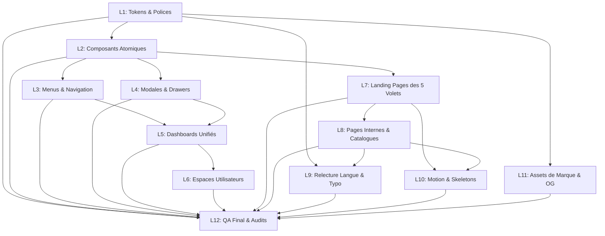

# PLAN D'EXÉCUTION DES CORRECTIONS DESIGN · ENVOL AFRICA
**Feuille de Route Opérationnelle par Lots Atomiques (L1 à L12)**
*Périmètre Front-End Exclusif · Zéro Régression Métier · Transition vers la Charte Magazine/Kiosque*

---

## 1. PRINCIPES D'EXÉCUTION & CADRE DE SÉCURITÉ

1. **Activation conditionnelle** : Aucune ligne de code ne sera modifiée avant réception de l'instruction explicite du propriétaire : `« OK »` (pour tous les lots) ou `« OK L... »` (pour un lot spécifique).
2. **Commits atomiques et réversibilité absolue** : Chaque lot fait l'objet d'un commit Git dédié et vérifié. En cas de désaccord, un rollback instantané vers le commit `58f10a8` ou la sauvegarde `lastbackup` est garanti.
3. **Périmètre sanctifié inviolable** :
   - Préservation stricte de la logique financière Moneroo, des webhooks, de la base de données, des règles RLS, des flux d'authentification et des composants d'en-tête (`Header.tsx` et `HeaderShell.tsx`).
   - Aucune modification des règles de visibilité des données (l'affilié ne voit que son total global).
   - Affichage monétaire standardisé strictement en `XOF`.

---

## 2. SYNTHÈSE DE LA FEUILLE DE ROUTE (12 LOTS)

| Lot | Titre du Chantier | Constats Couverts | Fichiers Principaux | Effort | Dépendances |
|:---:|:---|:---:|:---|:---:|:---:|
| **L1** | Tokens & Polices (Charte Référence) | D-001, D-002, D-004, D-010 | `globals.css`, `layout.tsx` | **S** | Aucune |
| **L2** | Composants de Base & Icônes SVG | D-007, D-008, D-009, D-026 | `components/ui/*` | **M** | L1 |
| **L3** | Menus, Navigation & Bottom Bar | D-010, D-011, D-012 | `Header*`, `Footer.tsx`, `BottomNav.tsx` | **M** | L1, L2 |
| **L4** | Pop-ups, Modales & Drawers | D-013, D-014, D-015 | `Modal.tsx`, `Dialog.tsx`, `Drawer.tsx` | **M** | L1, L2 |
| **L5** | Dashboards Communs & KPI | D-016, D-017, D-018 | `app/dashboard/*`, `DashboardShell.tsx` | **L** | L2, L3, L4 |
| **L6** | Espaces Utilisateurs & Wallets | D-019, D-020, D-034 | `app/compte/*`, `WalletView.tsx` | **M** | L2, L5 |
| **L7** | Refonte des 5 Landing Pages | D-005, D-006, H-Audit | `africa-awards`, `emploi`, `marketplace`, `financement`, `wab` | **L** | L1, L2, L3 |
| **L8** | Pages Internes, Fiches & Articles | D-021, D-022, D-024 | `app/marketplace/*`, `app/mag/*` | **L** | L2, L7 |
| **L9** | Langue Française & Typographie | D-038, Q-Audit (472 cas) | Multiples fichiers JSX | **M** | L7, L8 |
| **L10**| Motion, Skeletons & A11y | D-029, D-030, D-032 | `Skeleton.tsx`, `PageTransition.tsx` | **M** | L7, L8 |
| **L11**| Assets de Marque & Favicons | D-036, D-037 | `public/*`, métadonnées `layout.tsx` | **S** | L1 |
| **L12**| Contrôle Qualité Final & Audits | D-031, D-033, D-035 | Tout le dépôt | **M** | Tous |

---

## 3. DÉTAIL OPÉRATIONNEL LOT PAR LOT

### Lot L1 — Tokens de Style, Polices & Bannissement des Polices d'Icônes
- **Objectif** : Asseoir les fondations universelles du système de design en intégrant la palette Magazine/Kiosque dans Tailwind v4 et éliminer définitivement le clignotement de texte des icônes.
- **IDs Couverts** : `D-001`, `D-002`, `D-004`, `D-010`.
- **Fichiers impactés** :
  - `app/globals.css` : Définition des variables `@theme` (Bordeaux impérial `#9e001f`, Crème `#fcf9f8`, Espresso `#2b2525`, etc.).
  - `app/layout.tsx` : Retrait du lien externe Google Font `Material Symbols Outlined`. Optimisation des imports `next/font/google` pour `Source Serif 4` et `Montserrat` avec `display: swap`.
- **Avant / Après** :
  - *Avant* : Classes arbitraires `bg-[#087e8b]`, `bg-[#0D0D0D]` éparpillées ; icônes clignotant en texte brut.
  - *Après* : Variables sémantiques universelles ; 0ms de temps de blocage de police d'icônes.
- **Effort** : **S** (< 2h).
- **Risques & Mitigations** : Risque mineur de régression visuelle sur les icônes retirées -> Fournir immédiatement un proxy SVG temporaire pour les Material Symbols restants.
- **Critères d'acceptation** : Build réussi sans avertissement ; suppression du fichier WOFF2 Material Symbols dans l'onglet Réseau ; conformité des tokens CSS.

---

### Lot L2 — Socle de Composants Atomiques & Bibliothèque d'Icônes SVG
- **Objectif** : Standardiser les briques d'interface fondamentales (Boutons, Cartes, Champs, Badges, Toasts) via CVA et `lucide-react`.
- **IDs Couverts** : `D-007`, `D-008`, `D-009`, `D-025`, `D-026`.
- **Bibliothèques introduites** : `class-variance-authority` (1.4 Ko), `clsx` (500 o), `tailwind-merge` (3.2 Ko), `lucide-react` (SVG tree-shakable), `sonner` (toasts élégants, 3 Ko).
- **Fichiers créés / modifiés** :
  - `src/components/ui/button.tsx` : 5 variantes (`primary`, `secondary`, `outline`, `ghost`, `danger`) avec gestion de `loading spinner` et `min-h-[44px]` sur mobile.
  - `src/components/ui/card.tsx` : Rayon `rounded-xl`, bordure `#ead8d5`, élévation feutrée.
  - `src/components/ui/input.tsx` : Champ crème, focus bordeaux impérial.
  - `src/components/ui/badge.tsx` : Badges sémantiques haute lisibilité.
- **Avant / Après** :
  - *Avant* : 18 styles de boutons bricolés dans le DOM ; boutons trop petits sur mobile.
  - *Après* : 1 seul composant `<Button variant="..." size="...">` hautement typé et accessible.
- **Effort** : **M** (demi-journée).
- **Risques & Mitigations** : Risque de conflits de styles -> Utilisation de `tailwind-merge` pour préserver les surcharges locales contrôlées.
- **Critères d'acceptation** : Zones tactiles ≥ 44px vérifiées sur émulateur 360px ; navigation clavier avec anneau de focus contrasté.

---

### Lot L3 — Menus, Navigation Globale & Barre Mobile Basse
- **Objectif** : Perfectionner l'expérience de navigation entre les 7 volets et doter la version smartphone d'une ergonomie d'application native.
- **IDs Couverts** : `D-010`, `D-011`, `D-012`.
- **Fichiers impactés** :
  - `components/HeaderShell.tsx` : Harmonisation des contrastes et de l'indicateur de volet actif.
  - `components/Footer.tsx` : Unification du pied de page avec labels légaux complets et logos des moyens de paiement Moneroo.
  - `components/BottomNav.tsx` (création) : Barre basse mobile discrète donnant un accès direct : Magazine, Kiosque, Explorer, Panier/Actions, Compte.
- **Avant / Après** :
  - *Avant* : Sélecteur de volet peu intuitif sur petit écran ; footer amputé selon les pages.
  - *Après* : Fluidité de passage immédiate d'un volet à l'autre ; navigation au pouce naturelle.
- **Effort** : **M** (demi-journée).
- **Risques & Mitigations** : Risque de chevauchement de la barre basse sur les boutons de bas de page -> Ajout systématique de `pb-20 md:pb-0` sur les layouts.
- **Critères d'acceptation** : Navigation testée sans aucun décalage à 360, 390 et 768px.

---

### Lot L4 — Pop-ups, Modales & Tiroirs Mobiles (Drawers)
- **Objectif** : Éradiquer les modales artisanales instables au profit d'overlays accessibles et élégants.
- **IDs Couverts** : `D-013`, `D-014`, `D-015`.
- **Bibliothèques introduites** : `@radix-ui/react-dialog` (accessible, focus-trap certifié) et `vaul` (tiroir coulissant mobile).
- **Fichiers impactés** :
  - `components/ui/dialog.tsx` : Modale universelle avec fond crème, liseré bordeaux, blocage du défilement d'arrière-plan.
  - `components/ui/drawer.tsx` : Tiroir tactile par le bas pour smartphones.
  - Modales d'authentification, de sélection d'abonnements et de confirmation de paiement.
- **Avant / Après** :
  - *Avant* : Page arrière qui défile sous la modale ; impossibilité de quitter avec `Échap` sur desktop.
  - *Après* : Transition d'estompage pure ; fermeture universelle tactile et clavier ; piège de focus WCAG AA.
- **Effort** : **M** (demi-journée).
- **Critères d'acceptation** : Test clavier (Tabulation reste dans la modale) ; test mobile tactile (fermeture par glissement vers le bas).

---

### Lot L5 — Gabarit de Dashboard Unifié & Tableaux Responsives
- **Objectif** : Rassembler les 6 espaces d'administration et de gestion sous un gabarit unique `DashboardShell` prestigieux.
- **IDs Couverts** : `D-016`, `D-017`, `D-018`.
- **Fichiers impactés** :
  - `components/dashboard/DashboardShell.tsx` (création) : Sidebar espresso bordeaux `#2b2525`, barre supérieure d'actions rapides, gestion responsive.
  - `components/dashboard/MetricCard.tsx` : Carte KPI avec tendance, icône vectorielle et micro-jauge.
  - `components/dashboard/ResponsiveTable.tsx` : Tableau basculant en cartes individuelles sur écran < 768px.
  - `app/admin/*`, `app/vendeur/*`, `app/porteur/*`, `app/recruteur/*`.
- **Avant / Après** :
  - *Avant* : 6 designs disparates, tableaux coupés avec scrollbar hideuse sur smartphone.
  - *Après* : Sentiment de suite logicielle de luxe unifiée ; tableaux parfaitement consultables sur mobile.
- **Effort** : **L** (1 journée).
- **Critères d'acceptation** : Zéro modification de la logique d'autorisation ou des flux de données Supabase ; responsive vérifié à 360px.

---

### Lot L6 — Espaces Utilisateurs, Profils & Affichage Monétaire XOF
- **Objectif** : Polir les écrans de compte personnel et garantir l'uniformité monétaire absolue `XOF`.
- **IDs Couverts** : `D-019`, `D-020`, `D-034`.
- **Fichiers impactés** :
  - Pages de profil, commandes, historique, wallet et paramètres.
  - Fonctions de formatage monétaire : remplacement de toute occurrence de `FCFA` par `XOF` avec séparateurs d'espaces insécables (ex. `10 000 XOF`).
- **Avant / Après** :
  - *Avant* : Mélange de devises `FCFA` / `XOF` ; pages de compte brutes.
  - *Après* : Clarté financière irréprochable ; espaces profil élégants et rassurants.
- **Effort** : **M** (demi-journée).
- **Critères d'acceptation** : Zéro occurrence de `FCFA` ou `F CFA` dans l'interface utilisateur ; soldes et gains impeccablement alignés.

---

### Lot L7 — Refonte Visuelle des Landing Pages des 5 Volets
- **Objectif** : Transformer les pages d'atterrissage des 5 volets pour les hisser au niveau esthétique d'agences primées, dans la charte Magazine/Kiosque.
- **IDs Couverts** : `D-005`, `D-006`, ensemble du critère H.
- **Fichiers impactés** :
  - `app/africa-awards/page.tsx` : Ambiance grande cérémonie d'État, fond espresso `#2b2525`, titrages `Source Serif 4`, dorures satinées `#d4af37`, mise en scène héroïque des lauréats.
  - `app/emploi/page.tsx` : Redesign façon cabinet exécutif international, cartes de recrutement de prestige, filtres clairs.
  - `app/marketplace/page.tsx` : **Création de la landing vitrine officielle** de la Marketplace mettant en lumière l'artisanat d'art, la mode et l'agro-business d'exception (le catalogue restant accessible en direct).
  - `app/financement/page.tsx` : Rajeunissement chaleureux du crowdfunding, valorisation humaine des porteurs et modernisation graphique du simulateur ROI.
  - `app/wab/page.tsx` : Élévation de l'interface vers le grand club d'affaires panafricain.
- **Avant / Après** :
  - *Avant* : 5 univers graphiques dissonants et parfois austères ou trop sombres.
  - *Après* : 5 portes d'entrée magistrales d'un seul empire média et commercial panafricain.
- **Effort** : **L** (1.5 journée).
- **Critères d'acceptation** : Préservation intégrale des boutons de paiement Moneroo et des formulaires d'interaction ; rendu visuel spectaculaire aux 5 largeurs d'écran.

---

### Lot L8 — Pages Internes, Fiches Produits & Catalogues
- **Objectif** : Harmoniser le rythme de lecture des fiches produits, fiches de projets, annonces d'emploi et articles de presse.
- **IDs Couverts** : `D-021`, `D-022`, `D-024`.
- **Fichiers impactés** : Fiches détaillées dans `/marketplace/[id]`, `/financement/[id]`, `/emploi/[id]`, `/articles/[slug]`.
- **Avant / Après** :
  - *Avant* : Fiches encombrées sans réassurance d'achat visible.
  - *Après* : Galeries photos cadrées avec ratios stricts, bandeaux de réassurance Moneroo omniprésents, typographie reposante.
- **Effort** : **L** (1 journée).
- **Critères d'acceptation** : Formulaires d'ajout au panier et de candidature testés sans aucune altération de payload.

---

### Lot L9 — Correction Intégrale de la Langue & Typographie Française
- **Objectif** : Nettoyer l'intégralité des 472 coquilles typographiques (espaces insécables) et instaurer le vouvoiement universel.
- **IDs Couverts** : Ensemble du catalogue Q.
- **Méthode** :
  - Remplacement automatisé et vérifié des ponctuations hautes (`:`, `;`, `!`, `?`) par leur équivalent précédé de l'espace insécable `\u00A0` ou `&nbsp;`.
  - Harmonisation éditoriale : passage systématique au vouvoiement (« Vous »).
  - Remplacement des anglicismes disgracieux par les termes français de référence.
- **Avant / Après** :
  - *Avant* : Ponctuations orphelines renvoyées à la ligne sur mobile (« Panier ! » coupé) ; tutoiement discordant.
  - *Après* : Langue française académique irréprochable et respectueuse de la clientèle d'élite.
- **Effort** : **M** (demi-journée).
- **Critères d'acceptation** : Script d'analyse linguistique retournant 0 anomalie sur les chaînes JSX visibles.

---

### Lot L10 — Motion, Skeletons de Chargement & Performance Mobile
- **Objectif** : Apporter la fluidité et le raffinement cinétique tout en optimisant le temps de chargement sur réseau mobile 3G/4G dégradé.
- **IDs Couverts** : `D-029`, `D-030`, `D-032`.
- **Fichiers impactés** :
  - Composants de chargement (`Skeleton.tsx`) avec shimmer bordeaux/ivoire satiné.
  - Respect strict de `prefers-reduced-motion`.
- **Avant / Après** :
  - *Avant* : Écrans blancs ou sauts brutaux lors des chargements asynchrones.
  - *Après* : Squelettes de prévisualisation doux, sensation de vélocité instantanée.
- **Effort** : **M** (demi-journée).
- **Critères d'acceptation** : Score LCP < 2.5s et CLS < 0.05 mesurés sous réseau mobile bridé.

---

### Lot L11 — Actifs de Marque, Favicons & Bannières Open Graph
- **Objectif** : Compléter les assets visuels pour un partage social prestigieux sur WhatsApp, LinkedIn, X et Facebook.
- **IDs Couverts** : `D-036`, `D-037`.
- **Fichiers impactés** : `app/**/opengraph-image.tsx`, dossiers `public/favicons/`.
- **Avant / Après** :
  - *Avant* : Image de partage générique ou manquante lors de l'envoi d'un lien d'offre d'emploi ou de projet.
  - *Après* : Carte de prévisualisation sur-mesure arborant le blason Envol Africa et le titre de la ressource.
- **Effort** : **S** (< 2h).
- **Critères d'acceptation** : Validation par le debugger Open Graph officiel.

---

### Lot L12 — Contrôle Qualité Final, Audits Accessibilité & Non-Régression
- **Objectif** : Valider l'intégralité des critères du prompt initial avant livraison définitive.
- **Vérifications exécutées** :
  - Audit Lighthouse sur 5 pages types (Performance, Accessibilité, Bonnes Pratiques, SEO).
  - Contrôle WCAG AA (aucun ratio de contraste < 4.5:1 sur texte normal).
  - Test exhaustif des parcours critiques :
    1. Achat d'une édition sur le Kiosque via Moneroo (vérification du déclenchement du paywall page 8).
    2. Soumission d'une candidature Jobs.
    3. Vote Africa Awards.
    4. Contribution Crowdfunding.
    5. Achat Marketplace.
    6. Connexion et consultation du Dashboard sans régression de droits.
- **Effort** : **M** (demi-journée).
- **Critères d'acceptation** : Zéro erreur console ; zéro régression financière ou backend ; rapport de validation complet.

---
*Fin du plan d'exécution des corrections — Document opérationnel rédigé en attente de l'approbation du propriétaire.*
